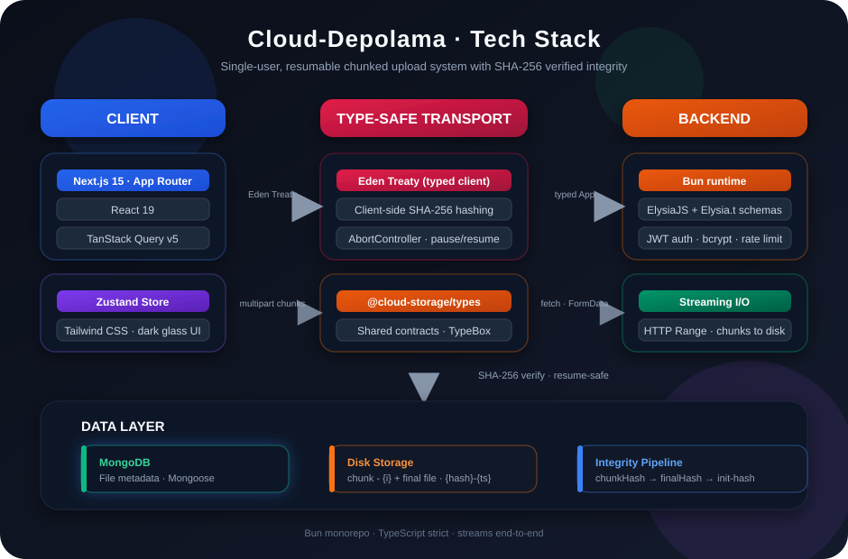

# ☁️ Cloud-Depolama

> Single-user, production-grade **resumable chunked file upload** system with SHA-256 verified integrity, streaming I/O and a modern dark glassmorphism UI.

<p align="center">
  
</p>

End-to-end typesafety is guaranteed by **Eden Treaty** — the Next.js client consumes the backend's Elysia `App` type directly, so route names, payloads and responses are type-checked at compile time.

---

## ✨ Features

| Feature | Description |
|---|---|
| **Chunked uploads** | Files are split into 1KB–100MB chunks (`POST /upload/init` → `/upload/chunk` → `/upload/complete`) |
| **SHA-256 integrity** | Client hashes the full file and every chunk; server re-verifies chunk hashes and the assembled file hash (double-checked against both the submitted `finalHash` and the init-declared hash) |
| **Resumable** | Pause mid-upload, resume from the next missing chunk, even after a page refresh (`attachFileAndResume`) |
| **Streaming assembly** | The final file is assembled by streaming chunks through a hash pipe — **never buffered in memory** |
| **Retry & resilience** | 3 attempts per chunk with exponential backoff, per-file `AbortController` |
| **JWT auth (single user)** | First registration locks the system (atomic claim slot); httpOnly session cookie, 7-day expiry |
| **File manager** | Search, category filters, preview (image/video/text), download, soft delete, bulk delete |
| **Streaming downloads** | Native HTTP `Range` support for audio/video scrubbing, `X-SHA256` response header, RFC 5987 filename encoding (Turkish chars) |
| **Monitoring** | Upload stats (`/stats`) polled every 5s, file list polling every 10s |
| **Text notes** | Create a `.txt` note and upload it through the same chunked pipeline |

## 🧱 Architecture

```
┌──────────────────┐   Eden Treaty (typed)   ┌──────────────────────┐
│  Next.js 15       │ ─────────────────────► │  Bun + ElysiaJS       │
│  App Router       │   credentials:include  │  ┌──────────────────┐ │
│  React 19         │                        │  │ Auth (JWT cookie)│ │
│  React Query      │   fetch (FormData)     │  │ Upload routes    │ │
│  Zustand store    │ ─────────────────────► │  │ Files/Download   │ │
│  Tailwind (dark)  │                        │  └──────────────────┘ │
└──────────────────┘                        └──────────┬───────────┘
                                                     │ streams (no buffer)
                                        ┌────────────┴────────────┐
                                        │ MongoDB (File metadata) │
                                        │ Disk (chunks + final)   │
                                        └─────────────────────────┘
```

See the graphical stack overview in [`docs/tech-stack.svg`](docs/tech-stack.svg).

### Upload flow

1. **`POST /upload/init`** — client validates geometry (`fileSize`, `chunkSize`, `totalChunks`), submits the file SHA-256 → a pending `File` record + a `{hash}-{timestamp}` storage dir is created
2. **`POST /upload/chunk`** — multipart chunk with its SHA-256; server checks index bounds, exact per-chunk size, and hash before writing `chunk-{i}` to disk; already-uploaded chunks are skipped (resume)
3. **`POST /upload/complete`** — chunks are streamed through SHA-256 into the final file; the digest must match **both** the client `finalHash` and the init-declared `fileHash`, otherwise the partial file is removed and the upload is marked failed

## 🔒 Security highlights

- **JWT cookie auth on every state-changing route** — an inline `onBeforeHandle` barrier protects `/upload/*`, `/files/*` and `/stats`; public routes are limited to `/`, `/health` and `/api/auth/*`
- **Path traversal hardened** — `fileHash` must be a 64-hex digest, `fileName` is sanitized to a safe basename, and every stored/derived path is checked to resolve inside `STORAGE_DIR` before any read/write/cleanup
- **No full-file buffering** — chunk-level memory is bounded (≤100MB) and final assembly is streamed
- **Per-chunk size enforcement** — chunk bytes must exactly match the computed expectation derived from `fileSize`/`chunkSize`; out-of-range chunk indexes are rejected
- **CSRF defense** — cookie-authenticated `POST`/`DELETE` requests require an allowlisted `Origin` header
- **Brute-force protection** — per-IP fixed-window rate limit (10 req/min) on login
- **Safe serving** — `X-Content-Type-Options: nosniff` + `Content-Security-Policy: sandbox` on downloads; `inline` disposition only for image/video/audio/PDF, everything else is forced to `attachment`; `mimeType` is validated as a `type/subtype` token
- **Fail-safe secrets** — production refuses to boot without `JWT_SECRET`; development falls back to an ephemeral generated secret with a loud warning
- **Loopback by default** — the server binds `127.0.0.1` (override with `HOST`)

## 🚀 Getting started

**Prerequisites:** [Bun](https://bun.com) ≥ 1.1, a running MongoDB instance, Node-compatible terminal.

```bash
# 1. Install dependencies (workspace: backend + client + packages/types)
bun install

# 2. Configure environment
cp backend/.env.example backend/.env
cp client/.env.example client/.env
# ⚠️ Set a long random JWT_SECRET in backend/.env

# 3. Start both apps
bun run dev          # backend → http://localhost:3001, client → http://localhost:3000

# 4. Open the client and register the single admin account
#    Registration locks itself forever after the first user
```

### Environment variables (`backend/.env`)

| Var | Default | Purpose |
|---|---|---|
| `MONGODB_URI` | `mongodb://localhost:27017/cloud-storage` | Mongo connection |
| `PORT` | `3001` | API port |
| `HOST` | `127.0.0.1` | Bind address |
| `STORAGE_DIR` | `./storage` | Chunk + final file storage |
| `JWT_SECRET` | *(development: ephemeral + warning)* | Session signing secret — **required in production** |
| `ALLOWED_ORIGINS` | `http://localhost:3000` | CORS/CSRF allowlist |
| `MAX_FILE_SIZE` | `53687091200` (50GB) | Max upload size |

### API surface

| Route | Method | Auth | Purpose |
|---|---|---|---|
| `/health` | GET | — | Health + Mongo state |
| `/api/auth/register` | POST | — | Create the (one) admin |
| `/api/auth/login` | POST | — | Login, sets httpOnly JWT cookie |
| `/api/auth/logout` | POST | — | Clear session |
| `/api/auth/setup-status` | GET | — | `{ hasUser }` → register-or-login UI |
| `/api/auth/me` | GET | cookie | Current user |
| `/upload/init` | POST | cookie | Initialize chunked upload |
| `/upload/chunk` | POST | cookie | Upload one chunk (multipart) |
| `/upload/complete` | POST | cookie | Stream-assemble + verify final hash |
| `/upload/:fileId` | GET / DELETE | cookie | Upload status / cancel |
| `/files` | GET | cookie | List files (last 50) |
| `/files/:id/download?inline=true` | GET | cookie | Stream download (Range) |
| `/files/:id` | DELETE | cookie | Soft delete |
| `/stats` | GET | cookie | Upload statistics |

## 🛠 Scripts

```bash
bun run dev       # run backend + client concurrently
bun run typecheck # backend + client typecheck
bun run lint      # eslint (flat config)
bun run test      # backend + client tests (bun test)
```

## 📁 Workspace layout

```
cloud-storage-monorepo/
├── backend/
│   └── src/
│       ├── index.ts          # Elysia app, CORS, barrier, download, graceful shutdown
│       ├── routes/
│       │   ├── auth.ts       # JWT auth routes + rate limiting
│       │   └── upload.ts     # chunked upload pipeline + hash streaming
│       ├── models/           # Mongoose File + User
│       ├── config/           # database.ts, env.ts (fail-safe env validation)
│       └── …
├── client/
│   ├── app/                  # App Router pages (home, files, login, register)
│   ├── components/           # UploadList, FileList, FileItem, modals…
│   ├── hooks/                # useUpload (upload engine), useFiles
│   └── lib/                  # Eden Treaty client, zustand store, error handler
├── packages/types/           # @cloud-storage/types shared contracts
└── docs/
    └── tech-stack.svg        # graphical stack overview
```

## 🗺 Roadmap ideas

- Real dedup: reuse identical-content storage paths instead of `{hash}-{timestamp}` dirs
- Background cleanup for soft-deleted files on disk
- Multipart streaming directly from `request.body` to disk (skip FormData buffering)

---

Made with 🦊 Bun and ☕️ in Türkiye.
